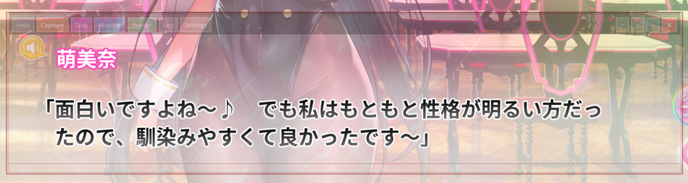
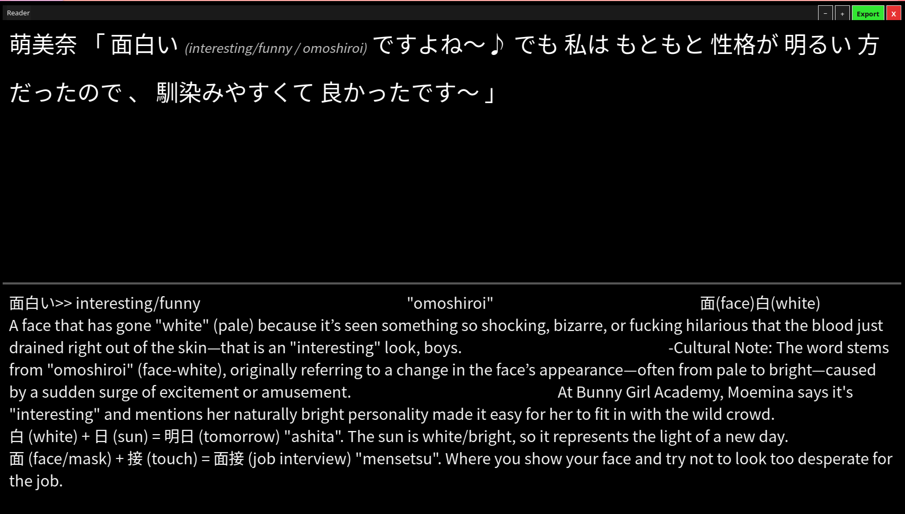

# Japanese Translator, KDE Plasma edition

**Read Japanese games and visual novels as you play, and turn what you meet into
RemNote flashcards, without leaving the game.**

A quiet, always-on-top translator for **Linux (KDE Plasma, X11)**. You place a
see-through frame over the text you want to read. One key press sends what is
inside it to a vision-capable AI model, and you get back the Japanese split into
clickable words with meanings, plus flashcards on demand.



## What you get

- **A workflow in four steps:** frame the text, press Capture (Shift+S), read it as
  clickable words in the Reader, and click words to build flashcards you export to RemNote.
- **It stays out of the way.** The inside of the frame is *click-through*, so you
  keep clicking the game's own buttons through it. The border and toolbar fade down
  to almost nothing, and Hide leaves only a Capture button.
- **No OCR or server to install.** Images go straight to a vision model through
  [OpenRouter](https://openrouter.ai); you only need an API key.
- **Fast and exact.** The capture takes about 15 ms and is pixel-exact on any monitor.
  Capture and translation run in the background, so the interface never freezes.
- **Snip anything.** Drag a box around any other part of the screen and just that
  area is translated the same way.
- **Easy to diagnose.** A rotating log file, a Log window and a Copy-all button.



It is a Python + PyQt6 rewrite of the original Windows app.

## How it works

```
 frame position  ->  grab pixels  ->  vision model  ->  Reader  ->  click a word  ->  flashcard
 (X server)         (root window,      (OpenRouter)     (words +     (meaning, then    (RemNote text,
                     ~15 ms)                             meanings)    flashcard)        Export = copy)
```

1. **Capture.** Press **Capture** (or **Shift+S**). The app asks the X server
   exactly where the frame is, reads those pixels from the screen (about 15 ms,
   pixel-exact on any monitor), and crops away the border and toolbar. Nothing
   is drawn on the frame to find it, and nothing but the frame's inside is sent.
2. **Translate.** The cropped image goes to the vision model you chose in
   Settings. The reply is the Japanese text split into chunks, each with an
   English meaning and romaji.
3. **Read.** The **Reader** shows the sentence as clickable words. Click a word
   to show its meaning; click again to also show the romaji.
4. **Learn.** The first click on a word also asks a second model for a short
   RemNote-formatted flashcard (meaning, kanji breakdown with radicals, a
   memory hook), using the game name from Settings for context. **Export**
   copies all flashcards for pasting into RemNote.

The **Monitor** window shows exactly the pixels that were sent, which is handy
for checking that the frame is lined up.

## Requirements

- KDE Plasma on an **X11** session (tested on Plasma 5.27, Pop!_OS 24.04).
- Python 3.12 with PyQt6 and numpy (`requests` is installed by `run.sh`).
- A free or paid **OpenRouter** API key.
- A font with Japanese glyphs (Noto Sans CJK JP is used when present).
- `spectacle` is only needed on Wayland sessions, which use a slower
  full-screenshot fallback (see below).

## Install and run

```bash
cd linux-kde
chmod +x run.sh
./run.sh
```

The first run creates a `.venv` and installs the requirements. Add your key
either way:

- paste it into **Settings**, or
- put `OPENROUTER_API_KEY=sk-or-...` in `~/.config/ujt-kde/keys.env`
  (`keys.env.example` shows the format; keep it out of the repository).
  `~/.config/ujt/keys.env` is also read, so a key from another edition works.

Running `./run.sh` again while the app is open just brings its windows forward.

## Using it

Drag the toolbar to move the frame and the corner grip to resize it, so that it
sits over the dialogue box. Then press **Capture** or **Shift+S**.

| Button | What it does |
|---|---|
| **Hide** / **Show** | Collapse the toolbar to just **Capture** and **Show**, leaving a nearly invisible frame. |
| **Capture** | Translate what is inside the frame. |
| **Snip** | Freeze the screen and drag a box around *anything* (a menu button, a name plate). Just that area is translated. Esc, right-click or switching away cancels. |
| **Monitor** | Preview of the last capture. It resizes itself to fit. |
| **Reader** | The translation as clickable words, and the flashcard pane. |
| **Log** | Everything the app is doing, with a **Copy all** button. |
| **Settings** | API key, models, game name, languages, prompts. |
| **−  +** | Fade the border and the whole toolbar. The buttons still work when faint. |
| **i** | Keys and tips in a small box that never grabs the mouse or keyboard. |

**Click-through:** clicks inside the frame go to the game underneath. Only the
border, the toolbar and the resize grip take the mouse.

The Reader, Monitor and Log windows resize from any edge or either bottom
corner. The Reader's **+ / −** change the text size.

### Keys

| Key | Action |
|---|---|
| Shift+S | Capture |
| Shift+R or F8 | Bring the frame to the front |
| Super+Shift+T | Pin or unpin above other windows |

### Optional global shortcuts

`./install-plasma-shortcuts.sh` registers two Plasma shortcuts, which work even
while a game has focus:

| Shortcut | Action |
|---|---|
| Super+Shift+U | Bring the frame over the game (`run.sh --raise`) |
| Super+Shift+J | Capture now (`run.sh --capture`) |

## Files and settings

| What | Where |
|---|---|
| Settings, window positions | `~/.config/ujt-kde/config.json` |
| Your prompts (editable in Settings) | `~/.config/ujt-kde/prompt.txt`, `flashcard_prompt.txt` |
| API key | `~/.config/ujt-kde/keys.env` (or Settings) |
| Diagnostic log | `~/.local/state/ujt-kde/ujt.log` |

Window positions are remembered per monitor.

## Troubleshooting

Everything the Log window shows is also written to
`~/.local/state/ujt-kde/ujt.log` (rotated). It starts with a report of the
environment (Python and Qt versions, session type, screens, capture method,
models) and records a window-layout snapshot and timings for each capture, plus
the traceback of any failed background job. Attach it when reporting a problem.

- **The frame is behind the game.** KWin can put an active fullscreen window
  above always-on-top windows. Press **Shift+R** or **F8** (or run
  `./run.sh --raise`), or run the game borderless-windowed.
- **"Capture failed: ... off the desktop".** Part of the frame is outside the
  screen area. Move it back.
- **Nothing happens on Capture.** Check the Log for a missing API key.
- **Snip box cannot span two monitors.** KWin will not give one window several
  screens, so each Snip box stays on one monitor.
- **Stuck screen.** The app takes no mouse or keyboard grabs, but if a desktop
  ever stops responding: press Esc, then Super; or press Ctrl+Alt+F3, log in
  and run `pkill -f "python -m ujt"`, then Ctrl+Alt+F1 or F2 to return.

### Wayland

Wayland has no global window coordinates, so this edition falls back to a
Spectacle full-desktop screenshot. The frame then shows four small pink corner
markers, and the capture looks for a rectangle of those markers of exactly the
frame's size (unrelated pink on screen cannot shift the result). It is slower
and less tested than the X11 path.

## For developers

```
ujt/
  app.py             wires capture -> OpenRouter -> Reader -> flashcards
  capture.py         frame geometry, pixel grab, exact-size marker search (Wayland)
  x11.py             libX11 via ctypes: root grab, window geometry, always-on-top
  diag.py            log file and startup report
  openrouter.py      API calls
  parser.py          model JSON -> chunks
  worker.py          background threads (the UI never blocks)
  windows/           capture frame, Reader, Monitor, Log, Settings, Snip overlay
tests/               marker search and parser tests
```

Run the tests with:

```bash
QT_QPA_PLATFORM=offscreen PYTHONPATH=. .venv/bin/python -m unittest discover -s tests
```

Design notes worth knowing:

- Capture and translation run on worker threads. The GUI thread only reads the
  frame's geometry.
- The frame's click-through is an X input shape that excludes the capture area
  (`setMask`), so the pixels you capture are the same pixels you click through to.
- No window takes an input grab (no `Qt.Popup`), so none can lock the desktop.
